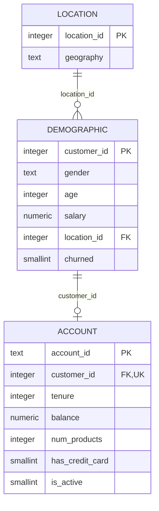

# Banking Customer Churn Analytics & Predictive Modeling

Python and PostgreSQL portfolio project analyzing 10,000 customer records, testing churn associations, and comparing classification models. A tuned random forest achieved **ROC AUC 0.8622** and **74.94% churn recall** on a fixed 2,000-customer test split.

**Status:** analytics and modeling complete. Tableau dashboard not complete yet

## Results at a glance

The selected pipeline detected **305 of 407 churners**, missed 102, and raised 272 false alarms. The decision threshold remained at 0.5 after model selection.

| Final test metric | Result |
|---|---:|
| ROC AUC | 0.8622 |
| Average precision | 0.6967 |
| Recall, churn class | 74.94% |
| Precision, churn class | 52.86% |
| F1 | 0.6199 |
| Accuracy | 81.30% |

| Actual / predicted | Retained | Churned |
|---|---:|---:|
| Retained | 1,321 | 272 |
| Churned | 102 | 305 |

Predicting everyone would stay would achieve 79.65% test accuracy but zero churn recall. This is why accuracy was not the selection metric. Results describe a retrospective classification experiment, not a deployed bank system or measured retention uplift.

## Workflow

1. Inspect the Excel workbook, missing values, categories, numerical ranges, unique IDs, and relationships.
2. Prepare three CSV tables and load them transactionally into PostgreSQL with primary/foreign-key constraints.
3. Explore churn by gender, country, age band, activity, balance availability, and product count using SQL.
4. Run a chi-square test, Welch's t-test, and Welch's ANOVA; report effect size or mean differences and interpretation limits.
5. Make a fixed stratified 80/20 split, checking for customer overlap.
6. Compare a dummy classifier, logistic regression, and random forest on the same five training folds.
7. Select among eight random forest configurations using mean validation F1; fit on all training rows and evaluate the fixed model on the test split.
8. Save the preprocessing/model pipeline and provide a CSV inference command.

## Data model



The schema permits at most one account record per customer. In this workbook, all 10,000 customers have one. [Field definitions](docs/data_dictionary.md) include unverified units and measurement timing.

## Main findings

- Overall churn was 20.37% (2,037 customers).
- Missing balance affected 36.17% of customers. It was retained as NULL; missingness was not assumed to mean zero.
- Inactive customers had 26.85% churn versus 14.27% for active customers. The exploratory chi-square test gave p = 5.9539e-55 and Cramér's V = 0.1561.
- Among recorded balances only, Welch's t-test did not find sufficient evidence of different means at alpha = 0.05 (p = 0.1738).
- Two-product customers had 7.58% churn; three- and four-product groups had 82.71% and 100%, but contained only 266 and 60 customers.

See [EDA findings](docs/eda_findings.md), [statistical findings](docs/statistical_findings.md), and [model experiments](docs/model_findings.md).

## Model comparisons

Mean scores from five stratified training folds:

| Model | Precision | Recall | F1 | ROC AUC | Average precision |
|---|---:|---:|---:|---:|---:|
| Dummy | 0.0000* | 0.0000 | 0.0000 | 0.5000 | 0.2037 |
| Logistic regression | 0.4222 | 0.7362 | 0.5366 | 0.8184 | 0.5815 |
| Initial random forest | 0.4610 | 0.7245 | 0.5634 | 0.8415 | 0.6489 |
| Selected random forest | 0.4880 | 0.6945 | 0.5730 | 0.8416 | 0.6532 |

*Dummy precision is undefined because it flags no churners; the code records zero. The selected forest's folds also guided tuning, so its CV score is a selection estimate, not an independent confirmation of improvement. Test scores are reported separately above.

## Run locally

Tested with Python 3.12.7 on an Apple M1 Mac and PostgreSQL 17.9. Run commands from the repository root. No Docker or Tableau is needed for this version.

```bash
git clone https://github.com/alnurturgaliyev/bank-churn-portfolio.git
cd bank-churn-portfolio
python3 -m venv .venv
source .venv/bin/activate
python -m pip install -r requirements-lock.txt
python scripts/download_data.py
python scripts/inspect_data.py > inspection_report.txt
python scripts/prepare_data.py
```

The lock file records the environment used for the saved results. Raw/derived customer data and the fitted binary are regenerated locally rather than bundled in Git. The downloader pins the source revision and verifies SHA-256.

### PostgreSQL route: full workflow

With PostgreSQL running, use the connection defaults below, or set the environment variables to your local values:

```bash
export PGHOST=localhost
export PGPORT=5432
export PGUSER=postgres
export PGDATABASE=bank_churn
```

Python scripts prompt for the database password without echoing it. They also accept `PGPASSWORD` from the environment. No `.env` file is loaded automatically.

For a new setup, create the empty database and tables using `psql`:

```bash
psql -h "$PGHOST" -p "$PGPORT" -U "$PGUSER" -d postgres -c 'CREATE DATABASE bank_churn;'
psql -h "$PGHOST" -p "$PGPORT" -U "$PGUSER" -d "$PGDATABASE" -v ON_ERROR_STOP=1 -f scripts/sql/create_tables.sql
python scripts/connection_test.py
python scripts/load_data.py
psql -h "$PGHOST" -p "$PGPORT" -U "$PGUSER" -d "$PGDATABASE" -f scripts/sql/verify_load.sql
```

Alternatively, execute the SQL files in a PyCharm PostgreSQL console connected to `bank_churn`. Existing users with populated tables should skip database creation and loading: the loader deliberately refuses nonempty tables, and this setup does not drop existing data.

Run the exploration queries in `scripts/sql/`, then:

```bash
python scripts/test_activity_churn.py
python scripts/test_balance_churn.py
python scripts/test_tenure_geography.py
python scripts/prepare_model_data.py
```

### CSV route: reproduce modeling without a database

After downloading and preparing the data, the following produces the same sorted modeling table and fixed customer split directly from the processed CSVs:

```bash
python scripts/prepare_model_data.py --from-csv
```

### Model experiments and final evaluation

```bash
python scripts/evaluate_baseline.py
python scripts/evaluate_logistic.py
python scripts/evaluate_random_forest.py
python scripts/tune_random_forest.py
python scripts/evaluate_final_model.py
python scripts/verify_artifacts.py
```

Each script writes its own results in `reports/`. The final script reads the selected parameters from `reports/random_forest_best_params.json` and saves the fitted pipeline in `models/churn_random_forest.joblib`. Do not retune using final test results. To reproduce only the selected model, run the final script with the committed best-parameter JSON after preparing the split.

### Score example customers

Once the model has been fitted:

```bash
python scripts/predict.py examples/customer_example.csv --output reports/example_predictions.csv
```

The example records are synthetic. Output contains the optional customer ID, predicted class, and an **uncalibrated churn score**. It is not a verified real-world probability. Load only a model artifact that you generated or otherwise trust.

## Repository layout

```text
docs/                 EDA, statistics, model results, and data provenance
examples/             Synthetic input for the prediction command
models/               Model metadata; fitted .joblib generated locally
reports/              Aggregate CV/search/test results
scripts/              Preparation, loading, statistics, modeling, scoring
scripts/sql/          Table definitions, verification, and EDA queries
requirements.txt      Direct dependencies
requirements-lock.txt Verified environment versions
```

## Evaluation limits and next steps

- Full-dataset EDA preceded the split. The test portion was excluded from model fitting and tuning, but is not wholly independent of earlier exploratory decisions.
- Real-bank provenance, the churn outcome window, and whether each feature predates churn are unverified. This is retrospective classification, not a validated prospective early-warning system.
- Exploratory statistical tests do not prove causation. Customer independence and representativeness cannot be established from the workbook alone.
- Gender is included as a model input. This is not a recommendation for operational targeting; subgroup performance and policy review have not been conducted.
- Scores are uncalibrated; no business contact budget, retention cost model, or intervention impact was measured.
- Tableau is planned separately. SVM and XGBoost are not implemented in this version.
